# 📦 Awesome Module Bundlers: Next-Gen Web Build Tools & Compilers

  
  
  
  
  
  
  

  

---

### 🌐 The Comprehensive Guide to JavaScript &amp; TypeScript Module Bundlers, ESM Dev Servers, and Rust/Go Build Systems

> **A rigorously curated directory of SaaS platforms, cloud build acceleration engines, and open-source module bundlers.**  
> *Covering Native ES Modules (ESM), Hot Module Replacement (HMR), Rust/Go-powered compilers, tree-shaking, code splitting, and legacy bundler migration paths.*

---

## 📑 Table of Contents

- [📊 Sector Overview &amp; Market Dynamics](#-sector-overview--market-dynamics)
- [☁️ SaaS &amp; Hosted Build Platforms](#️-saas--hosted-build-platforms)
- [🚀 Open-Source Module Bundlers &amp; Build Engines](#-open-source-module-bundlers--build-engines)
  - [⚡ Detailed Tool Breakdowns &amp; Architecture](#-detailed-tool-breakdowns--architecture)
- [🧩 Feature Matrix &amp; Architectural Comparison](#-feature-matrix--architectural-comparison)
- [🤝 How to Contribute](#-how-to-contribute)
- [⚖️ Disclaimer &amp; Methodology](#️-disclaimer--methodology)
- [📈 Star History](#-star-history)
- [💖 Support &amp; Sponsoring](#-support--sponsoring)

---

## 📊 Sector Overview & Market Dynamics

The global web development tooling, module bundling, and frontend cloud build infrastructure market was valued at **$5.8 billion in 2024** and is projected to expand to **$14.2 billion by 2031** at a Compound Annual Growth Rate (**CAGR of ~13.5%**), driven by increasing complexity of Single-Page Applications (SPAs), Server-Side Rendering (SSR), and distributed edge runtimes.

The sector exhibits **moderate fragmentation with high technological velocity**:
- **Underlying Compilers & Bundling Engines**: Moving rapidly toward systems-level languages (Rust and Go). Pure JavaScript tooling is actively being rewritten or supplemented (Vite migrating to Rolldown, Webpack compatibility achieved via Rspack, SWC powering Next.js).
- **Market Concentration**: Open-source bundlers exhibit strong power-law adoption around **Vite** for greenfield development and **webpack** for enterprise legacy estates. However, the commercial SaaS and hosted build cloud tier remains moderately fragmented between hyperscale edge infrastructure providers (**Cloudflare**), specialized frontend application platforms (**Vercel**, **Netlify**), and distributed computational caching ecosystems (**Nx Cloud**, **StackBlitz**).
- **Anti-Monopoly Dynamics**: Because core web standards (ECMAScript Modules, HTTP/2 & HTTP/3 multiplexing, and WebAssembly) are open specifications, developer lock-in remains unusually low. Teams can swap bundlers without rewriting application business logic, preventing a winner-take-all monopoly.

---

## ☁️ SaaS & Hosted Build Platforms

The following hosted cloud platforms provide managed build pipelines, distributed computation caching, zero-install WebContainers, and production asset optimization. 

*Sorted in descending order by company scale / valuation:*

| 🏢 Platform / Service | 💰 Company Valuation / Scale | 💳 Starting Paid Pricing | 🎁 Free Tier Limits (Forever Plan or Trial) | ⚡ Core Bundling & Build Capabilities |
| :--- | :--- | :--- | :--- | :--- |
| **[Cloudflare Pages & Workers Builds](https://pages.cloudflare.com/)** | **~$40.0B Market Cap** *(NYSE: NET, ~$1.6B+ ARR)* | **$20.00/month** *(Pro plan billed monthly, or $240/year)* | **Free forever**: 500 production & preview builds/month, 1 concurrent build, unlimited static requests & bandwidth, 100 preview environments, and 100,000 Worker requests/day. | Global edge-native build pipelines, automatic git-based builds, integrated edge asset minification, and zero-latency CDN distribution. |
| **[Vercel (Turbopack Cloud & Builds)](https://vercel.com/)** | **$3.25B Valuation** *(Series E, ~$100M+ ARR)* | **$20.00/user/month** *(Pro tier billed monthly)* | **Free forever (Hobby)**: 6,000 build minutes/month, 100 GB fast data transfer/month, 1 concurrent build pipeline, and 100,000 serverless/edge function executions/month. | Native Turbopack cloud dev & build integration, Next.js Server Components bundling, automatic image/font optimization, and instant deploy previews. |
| **[Netlify (Build & Edge Platform)](https://www.netlify.com/)** | **$2.00B Valuation** *(Series D, ~$75M+ ARR)* | **$19.00/user/month** *(Pro tier billed annually, or $24/month monthly)* | **Free forever (Starter)**: 300 build minutes/month, 100 GB bandwidth/month, 1 concurrent build, and 500 edge function invocations/month. | Zero-config continuous integration & bundling, deploy previews on every PR, edge function asset bundling, and multi-framework build plugins. |
| **[StackBlitz (WebContainers Enterprise)](https://stackblitz.com/)** | **~$150M Valuation** *(Series A, $35M venture backing)* | **$9.00/user/month** *(Pro Membership billed annually, or $12/month monthly)* | **Free forever (Personal)**: Unlimited public sandboxes, browser-native WebContainer Node.js runtime, zero-install local Vite/esbuild bundler, and 1 concurrent private project workspace. | Runs complete Node.js runtimes and module bundlers (Vite, Next.js, Rollup) inside WebAssembly in browser tabs with millisecond HMR and zero security overhead. |
| **[Nx Cloud (Nrwl)](https://nx.app/)** | **~$100M Valuation** *(Estimated, ~$15M ARR)* | **$12.00/month** *(Base Pro team plan; includes remote cache credits)* | **Free forever (Community)**: 500 remote cache compute hours/month, unlimited remote cache hits for open-source repositories, and up to 3 team members. | Distributed Task Execution (DTE), computation caching for webpack/esbuild/Vite monorepos, and build graph parallelization across remote worker pools. |
| **[CodeSandbox (MicroVM Cloud Dev)](https://codesandbox.io/)** | **~$60M Valuation** *(Series A, $15.1M venture funding)* | **$15.00/user/month** *(Pro plan billed annually, or $18/month monthly)* | **Free forever**: 20 public sandboxes, 2 active MicroVM cloud containers (2 vCPUs, 2 GB RAM, 6 GB storage), and 400 VM runtime credits/month. | MicroVM-backed cloud development environments with instant dev server startup, live collaborative editing, and automatic dependency bundling. |

---

## 🚀 Open-Source Module Bundlers & Build Engines

Open-source tooling forms the foundation of modern web packaging. Below is the comprehensive ranking of projects, each featuring a live GitHub star badge linked directly to its community stargazers page.

*Sorted in descending order by GitHub Star count:*

1. **[Bun](https://github.com/oven-sh/bun)**  — All-in-one JavaScript/TypeScript runtime, package manager, test runner, and native bundler written in Zig.
2. **[Vite](https://github.com/vitejs/vite)**  — Next-generation frontend tooling powered by native browser ESM and esbuild for dev, with Rollup/Rolldown for production.
3. **[webpack](https://github.com/webpack/webpack)**  — The venerable industry titan offering unmatched configuration flexibility, loaders, code splitting, and enterprise ecosystem depth.
4. **[Parcel](https://github.com/parcel-bundler/parcel)**  — Zero-configuration build tool and bundler with a Rust-based compiler core and out-of-the-box asset handling.
5. **[esbuild](https://github.com/evanw/esbuild)**  — An extreme-speed JavaScript/TypeScript bundler and minifier written in Go from scratch.
6. **[SWC](https://github.com/swc-project/swc)**  — High-performance Rust-based compilation and bundling platform powering Next.js and modern Web build pipelines.
7. **[Gulp](https://github.com/gulpjs/gulp)**  — The streaming, Node.js stream-based task automation toolkit for complex multi-asset pipelines.
8. **[Turbopack](https://github.com/vercel/turbo)**  — Incremental Rust-based bundler by the creator of webpack and Vercel, designed as the successor to Webpack in Next.js.
9. **[Rollup](https://github.com/rollup/rollup)**  — The pioneering ES module bundler renowned for dead code elimination, optimal tree-shaking, and pristine library bundles.
10. **[Snowpack](https://github.com/FredKSchott/snowpack)**  — *(Deprecated)* The unbundled build tool that spearheaded the modern ESM dev server revolution before ceding to Vite.
11. **[Browserify](https://github.com/browserify/browserify)**  — The classic bundler that brought Node.js CommonJS `require()` modules to web browsers.
12. **[Rolldown](https://github.com/rolldown/rolldown)**  — Fast Rust-based bundler with Rollup-compatible APIs and Oxc parser, designed to unify Vite's dev and build toolchains.
13. **[Rspack](https://github.com/web-infra-dev/rspack)**  — High-performance Rust-based web bundler engineered by ByteDance with drop-in webpack API and loader compatibility.
14. **[Grunt](https://github.com/gruntjs/grunt)**  — *(Deprecated)* The pioneer configuration-driven JavaScript task runner that set the standard for early frontend automation.
15. **[tsup](https://github.com/egoist/tsup)**  — The zero-config, ultra-fast TypeScript library packager powered under the hood by esbuild.
16. **[Microbundle](https://github.com/developit/microbundle)**  — Zero-configuration Rollup wrapper for packaging minimal, modern npm libraries with multiple output targets (ESM, CJS, UMD).
17. **[Metro](https://github.com/facebook/metro)**  — Dedicated JavaScript bundler developed by Meta optimized for React Native mobile application performance and instant reloads.
18. **[Farm](https://github.com/farm-fe/farm)**  — Extremely fast Vite-compatible web build tool and incremental bundler written completely in Rust.
19. **[Rsbuild](https://github.com/web-infra-dev/rsbuild)**  — Modern, zero-config build tool and application layer built on top of Rspack from ByteDance.
20. **[unbuild](https://github.com/unjs/unbuild)**  — Unified JavaScript &amp; TypeScript build system by the UnJS team, integrating Rollup, esbuild, and automated `.d.ts` generation.

---

### ⚡ Detailed Tool Breakdowns & Architecture

#### 1. [Bun](https://github.com/oven-sh/bun) 
- **Architecture**: Implemented in Zig on top of JavaScriptCore (JSC). Operates as an integrated runtime, package manager, and bundler (`bun build`).
- **Core Strengths**: Unbelievable throughput (hundreds of thousands of lines compiled per second), native JSX/TS support, and zero separate compilation step for full-stack apps.
- **Trade-offs**: Non-V8 engine behavior occasionally surfaces subtle edge-case disparities compared to Node.js/Chromium environments; plugin ecosystem is still maturing.
- **Best For**: Full-stack JavaScript/TypeScript applications, high-throughput microservices, and standalone script bundling.

#### 2. [Vite](https://github.com/vitejs/vite) 
- **Architecture**: Native browser ESM during development (unbundled server serving individual modules on request) pre-bundled via **esbuild**; production builds compiled via **Rollup** (and transitioning to **Rolldown**).
- **Core Strengths**: Instant dev server cold start (sub-200ms), lightning-fast Hot Module Replacement (HMR) independent of app scale, and universal plugin system compatible with Rollup.
- **Trade-offs**: Discrepancies can theoretically arise between dev mode (esbuild + native ESM) and production builds (Rollup), though mitigate-able via integration testing.
- **Best For**: Modern Single Page Applications (React, Vue, Svelte, Angular, Solid) where developer ergonomics and instant feedback loops are paramount.

#### 3. [webpack](https://github.com/webpack/webpack) 
- **Architecture**: Dependency-graph compilation engine written in Node.js with extensible tapable plugin hooks, AST transformations, and custom loader pipelines.
- **Core Strengths**: Deepest and most mature ecosystem in web history. Supports intricate Module Federation, complex micro-frontends, custom asset loaders, and enterprise legacy codebases.
- **Trade-offs**: Significantly slower cold start and production compilation speeds compared to Go/Rust tools; complex configuration syntax with steep maintenance curves.
- **Best For**: Large-scale legacy enterprise web applications, complex monorepos with hundreds of custom plugins, and architectures relying heavily on Module Federation.

#### 4. [Parcel](https://github.com/parcel-bundler/parcel) 
- **Architecture**: Zero-config bundler featuring a multi-core Rust compilation core (`@parcel/core`), SWC-based transpilation, and persistent filesystem caching.
- **Core Strengths**: Works out of the box with HTML, CSS, JavaScript, WebAssembly, images, and fonts without writing any custom config files.
- **Trade-offs**: Slower initial cold start on massive codebases compared to raw esbuild; custom edge-runtime plugin hooks are less widespread.
- **Best For**: Rapid prototyping, full-stack static websites, and developers who refuse to write boilerplate configuration files.

#### 5. [esbuild](https://github.com/evanw/esbuild) 
- **Architecture**: Written from scratch in Go by Evan Wallace, utilizing heavily parallelized algorithms, shared memory structures, and custom AST parsers without third-party dependencies.
- **Core Strengths**: 10x to 100x faster than traditional JavaScript-based bundlers (cold build in 0.3s, 18ms HMR); powers the internal pre-bundling engines of Vite and tsup.
- **Trade-offs**: Intentionally limited plugin API to avoid performance degradation; does not perform AST-level TypeScript type checking or emit `.d.ts` declaration files.
- **Best For**: Node.js CLI tools, backend microservices, TypeScript-to-JavaScript compilation pipelines, and underlying engines for meta-bundlers.

#### 6. [SWC](https://github.com/swc-project/swc) 
- **Architecture**: Rust-based extensible compilation and bundling platform (`spack` / `@swc/core`) designed as a high-speed drop-in replacement for Babel and Webpack.
- **Core Strengths**: Powers the compilation layer in Next.js, Parcel, and Deno; 20x faster than Babel on multi-threaded CPU architectures.
- **Trade-offs**: Bundler feature set (`spack`) has taken a backseat to the compiler core, with teams leaning toward Rspack or Rolldown for full bundling capabilities.
- **Best For**: Drop-in Babel replacement, Next.js applications, and custom Rust-based WebAssembly build steps.

#### 7. [Gulp](https://github.com/gulpjs/gulp) 
- **Architecture**: Node.js streaming task runner using standard Vinyl virtual file streams to transform assets entirely in memory without writing temporary files to disk.
- **Core Strengths**: In-memory stream processing pipeline; exceptional for non-JS tasks like image optimization, SVGO conversion, CSS pre-processing, and multi-directory sync.
- **Trade-offs**: Not an AST-aware module bundler; lacks native ESM resolution, dynamic import splitting, and Hot Module Replacement out of the box.
- **Best For**: Multi-asset transformation pipelines, legacy asset preparation, and hybrid build workflows alongside bundlers.

#### 8. [Turbopack](https://github.com/vercel/turbo) 
- **Architecture**: Built in Rust by Tobias Koppers (webpack creator) using the **Turbo Engine**—an incremental computation and caching graph that remembers every function call.
- **Core Strengths**: Incremental compilation speed remains constant regardless of application size (median 28ms HMR on a 2,000-module app); native dev server default in Next.js 15+.
- **Trade-offs**: Tight coupling to Next.js and the Vercel ecosystem; standalone usage outside Next.js is not yet fully stabilized for arbitrary frameworks.
- **Best For**: Large-scale Next.js web applications, Server Components, and enterprise Next.js monorepos.

#### 9. [Rollup](https://github.com/rollup/rollup) 
- **Architecture**: JavaScript-native bundler utilizing static analysis on ES2015 modules to recursively identify and prune unused exports (Scope Hoisting and Tree-Shaking).
- **Core Strengths**: Generates the most compact, clean, and spec-compliant library output bundles (ESM, CJS, UMD); foundation for Vite's production builds.
- **Trade-offs**: Slower development server speeds when used standalone without Vite; requires plugins for CommonJS module interoperability.
- **Best For**: Open-source JavaScript and TypeScript libraries, SDKs, design systems, and npm package publishing.

#### 10. [Snowpack](https://github.com/FredKSchott/snowpack) 
- **Architecture**: Pioneer of the "unbundled development" paradigm, serving individual ESM files directly to the browser.
- **Status**: ⚠️ **Officially Deprecated since April 2022**. The creator and maintainers recommend all users migrate to Vite.
- **Best For**: Historical reference and legacy code maintenance only.

#### 11. [Browserify](https://github.com/browserify/browserify) 
- **Architecture**: Analyzes the AST of Node.js `require()` statements and recursively packs all dependencies into a single bundle containing browser shims for built-in Node modules (`buffer`, `crypto`, `stream`).
- **Status**: Maintenance mode with millions of legacy weekly downloads; lacks modern ESM features like dynamic imports and HMR.
- **Best For**: Maintaining vintage Node-in-browser applications; not recommended for new projects.

#### 12. [Rolldown](https://github.com/rolldown/rolldown) 
- **Architecture**: Written in Rust by the Vite Core team, integrating the Oxc parser and AST manipulator with 100% Rollup-compatible plugin and configuration APIs.
- **Core Strengths**: Bridges the gap between Vite's dev server and production bundler, replacing Rollup with a Rust engine up to 10x faster while preserving Vite/Rollup plugin interoperability.
- **Trade-offs**: Active development towards full 1.0 stability; ongoing alignment with complex community Rollup plugins.
- **Best For**: The future core of Vite, high-performance library bundling, and teams seeking Rollup functionality with Rust speed.

#### 13. [Rspack](https://github.com/web-infra-dev/rspack) 
- **Architecture**: Developed in Rust by ByteDance, offering a high-performance replacement for Webpack with native loader and plugin architecture compatibility.
- **Core Strengths**: 5x to 10x faster cold starts than Webpack 5 with drop-in compatibility for standard loaders (`babel-loader`, `postcss-loader`, `swc-loader`); supports React Compiler and persistent caching.
- **Trade-offs**: Smaller standalone plugin ecosystem than Vite (~35% of community plugins require slight adaptation).
- **Best For**: Migrating massive legacy Webpack enterprise apps to Rust-level build speeds without rewriting configuration logic.

#### 14. [Grunt](https://github.com/gruntjs/grunt) 
- **Architecture**: Configuration-over-code JavaScript task runner executing file-based tasks sequentially via `Gruntfile.js`.
- **Status**: ⚠️ **Deprecated / Legacy**. Writes temporary files to disk between steps, causing slow build times.
- **Best For**: Legacy project maintenance only; do not initialize new projects with Grunt.

#### 15. [tsup](https://github.com/egoist/tsup) 
- **Architecture**: Zero-config TypeScript library bundler powered by **esbuild** for lightning code generation and **Rollup/TypeScript** for generating pristine `.d.ts` declaration maps.
- **Core Strengths**: Instant builds, zero configuration needed, automatic dual-publishing (ESM + CommonJS), watch mode, and type declaration generation out of the box.
- **Trade-offs**: Targeted specifically at libraries and Node packages rather than browser SPAs requiring HTML/CSS injection.
- **Best For**: TypeScript npm packages, CLI tools, serverless microservices, and internal shared libraries.

#### 16. [Microbundle](https://github.com/developit/microbundle) 
- **Architecture**: Zero-configuration CLI tool built on top of Rollup, maintained by Jason Miller (creator of Preact).
- **Core Strengths**: Automatically reads `package.json` fields (`main`, `module`, `unpkg`) to emit optimized CJS, ESM, and UMD builds in a single step with built-in compression.
- **Trade-offs**: Slower compilation than esbuild/tsup for very large codebases; best kept to lightweight modules.
- **Best For**: Small, lightweight npm utilities and UI micro-libraries.

#### 17. [Metro](https://github.com/facebook/metro) 
- **Architecture**: JavaScript bundler designed by Meta specifically to handle the asset resolution, Hermes bytecode pre-compilation, and fast refresh cycles for React Native mobile apps.
- **Core Strengths**: Sub-second reload cycles over USB/WiFi debug bridges, native platform extension resolution (`.ios.js`, `.android.js`), and tight integration with Expo.
- **Trade-offs**: Tailored for React Native; not typically used for standard desktop or web application builds.
- **Best For**: React Native and Expo mobile applications.

#### 18. [Farm](https://github.com/farm-fe/farm) 
- **Architecture**: Written from scratch in Rust, featuring a unique "partial bundling" strategy that splits modules into balanced chunks to optimize cache invalidation and browser request counts.
- **Core Strengths**: Consistent performance between dev and production; compatible with Vite plugins and configuration semantics; sub-millisecond HMR updates.
- **Trade-offs**: Smaller community and ecosystem footprint compared to Vite and Rspack.
- **Best For**: Developers seeking an all-Rust Vite alternative with innovative partial-bundling caching algorithms.

#### 19. [Rsbuild](https://github.com/web-infra-dev/rsbuild) 
- **Architecture**: High-level application build framework powered by Rspack, providing pre-configured sensible defaults for React, Vue, Svelte, Solid, and Node.js.
- **Core Strengths**: Delivers the simplicity of Create React App or Vite with the 10x compilation velocity of Rspack and native Webpack loader compatibility.
- **Trade-offs**: Relies on Rspack's underlying ecosystem maturity; relatively new project under active iteration.
- **Best For**: Teams migrating existing Create React App (CRA) or Webpack applications to a modern, zero-config build environment.

#### 20. [unbuild](https://github.com/unjs/unbuild) 
- **Architecture**: Modern TypeScript build system created by the UnJS / Nuxt ecosystem, orchestrating Rollup, esbuild, and `mkdist` under a unified configuration.
- **Core Strengths**: Supports passive file copying, stubbing for instant local development without rebuilds (`jiti`), and automatic `.d.ts` generation.
- **Trade-offs**: Tailored primarily toward modern ESM modules and library authors rather than complex web applications.
- **Best For**: Node.js libraries, Nitro / Nuxt modules, and packages targeting modern JavaScript runtimes.

---

## 🧩 Feature Matrix & Architectural Comparison

| 📦 Bundler / Tool | 🦀 Core Language | ⚡ Dev Engine Strategy | 🏭 Production Engine | ✂️ Tree-Shaking | 🔄 HMR Speed | 🎯 Target Workload |
| :--- | :--- | :--- | :--- | :--- | :--- | :--- |
| **Bun** | Zig | In-memory JIT bundle | Native Bun packager | ✅ Advanced | ⚡ <15ms | Fullstack apps & APIs |
| **Vite** | TypeScript / Rust | Native ESM (esbuild) | Rollup / Rolldown | ✅ Optimal | ⚡ <30ms | Modern SPAs & SSR |
| **webpack** | JavaScript | Full bundle in memory | Webpack Compiler | ✅ Mature | 🐢 200–500ms | Large enterprise estates |
| **Parcel** | Rust + JS | Multi-core compilation | Rust compiler + SWC | ✅ High | ⚡ 40–60ms | Zero-config apps |
| **esbuild** | Go | Ultra-fast single pass | Native Go AST linker | ⚠️ Basic | ⚡ <10ms | Build pipelines & CLIs |
| **Turbopack** | Rust | Turbo Engine increment | Turbo Engine | ✅ In progress | ⚡ <20ms | Next.js & Server Components |
| **Rollup** | JavaScript | Bundle compilation | Native Scope Hoisting | ✅ Superior | 🐢 N/A (Standard) | JS/TS npm packages |
| **Rolldown** | Rust | Rollup-compatible Rust | Native Rust AST linker | ✅ Superior | ⚡ <15ms | Vite future & libraries |
| **Rspack** | Rust | Multi-threaded Rust | Rspack Rust compiler | ✅ High | ⚡ <25ms | Webpack migrations |
| **tsup** | Go / TS | esbuild transform | esbuild + Rollup dts | ✅ Good | ⚡ <15ms | TypeScript libraries |
| **Farm** | Rust | Partial bundling | Rust compiler | ✅ Partial bundle | ⚡ <10ms | High-perf SPAs |
| **Rsbuild** | Rust | Rspack core | Rspack core | ✅ High | ⚡ <25ms | Modern SPA applications |

---

## 🤝 How to Contribute

We welcome community contributions, benchmarks, and ecosystem updates! Follow these steps:

1. **Fork this repository** to your GitHub account.
2. Create a new branch: `git checkout -b add/new-bundler-or-feature`.
3. Add or update tool listings in `README.md`, ensuring:
   - Factual accuracy and links to official documentation.
   - For SaaS products: include starting tier pricing, free tier limits, and company scale.
   - For open-source projects: ensure the star badge with `style=social&color=white` links to `/stargazers`.
4. Run markdown linters and verify table rendering.
5. Submit a **Pull Request (PR)** with a clear description of your changes.

---

## ⚖️ Disclaimer & Methodology

- **Community-Curated**: This list is independently curated by the developer community and does not constitute a formal commercial endorsement.
- **Architectural Trade-offs**: There is no universal "best" bundler. Development speed, production bundle size, framework compatibility, and configuration complexity must be evaluated against your application's lifecycle stage.
- **Pricing & Tier Accuracy**: SaaS pricing models and free tier allocations change frequently. All pricing data is verified as of early 2026. Consult official vendor pricing pages for real-time tier updates.

---

## 📈 Star History

---

## 💖 Support & Sponsoring

Thank you for exploring **Awesome Module Bundlers**! If this curated guide, architectural breakdowns, and benchmark insights help you optimize your web builds and developer experience, please consider supporting the project:

- ⭐ **Star this repository** to improve visibility across the developer community.
- 🍴 **Fork and contribute** your tools, benchmarks, and migration recipes.
- 📢 **Share** with your engineering peers, team Slack, and social channels.
- ☕ **Sponsor & Buy a Coffee**: Support continuous research and maintenance via the [GitHub Sponsors Dashboard](https://github.com/sponsors/ishandutta2007).
