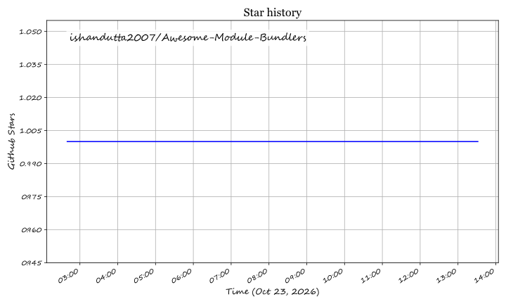

# Awesome-Module-Bundlers

## Top Monitoring & Observability Agents Ecosystem

**Curated List of SaaS Products & Open-Source GitHub Projects**  
*Focused on OpenTelemetry-Native Collection, Single-Binary Deployment & Vendor-Neutral Telemetry*  
**Last updated: March 2026**

This repository tracks notable **SaaS platforms** and **open-source projects** for **Monitoring & Observability Agents**. These tools are the collectors and forwarders that run on your hosts, containers, and Kubernetes clusters — gathering metrics, logs, traces, and profiles, enriching them with metadata, and shipping them to backends for analysis.

**Examples** include Grafana Alloy, OpenTelemetry Collector, Telegraf, Fluent Bit, Datadog Agent, and the commercial agents (the category leaders).

**Open-source emphasis**: This section is heavily expanded with every major active project for self-hosting, OTel-native pipelines, and transparent plugin architectures — ideal for platform engineers who want a single agent collecting all signals without locking into a proprietary vendor's telemetry format.

Contributions welcome! Open a PR to add/update entries. Keep descriptions factual and link to official sites.

## Table of Contents
- [SaaS/Hosted Platforms](#saas-hosted-platforms)
- [Open-Source GitHub Projects](#open-source-github-projects)
- [How to Contribute](#how-to-contribute)
- [Disclaimer](#disclaimer)

## SaaS/Hosted Platforms

- **Datadog Agent** — **The most feature-complete commercial agent** with native pipelines for metrics, logs, traces, and profiles. **The Datadog Distribution of the OpenTelemetry Collector (DDOT) is bundled in the Agent** and now sends series metrics using the v3 intake for reduced bandwidth [citation:1]. **Agents are built with Go 1.26.x** and support advanced features like APM injection on AMD64 systems running 32-bit binaries [citation:1]. **Best for Datadog customers** wanting a single agent collecting everything with managed backend integration.

- **New Relic Agent** — Commercial agent with language-specific SDKs and infrastructure monitoring. **Best for New Relic customers** wanting managed APM and infrastructure telemetry.

- **Dynatrace OneAgent** — Commercial agent with automatic discovery and deep code-level instrumentation. **Best for Dynatrace customers** wanting zero-configuration monitoring.

## Open-Source GitHub Projects

- **[Grafana Alloy](https://github.com/grafana/alloy)**  
  **The vendor-neutral distribution of the OpenTelemetry Collector** — Apache 2.0 licensed, **v1.16.0** with **OTel v0.147.0** [citation:2]. **Combines the strengths of leading collectors into one place** — whether observing applications, infrastructure, or both, Alloy can collect, process, and export telemetry signals to scale [citation:2]. **Native pipelines for Prometheus, OpenTelemetry, Loki, and Pyroscope** — logs, metrics, traces, and mature support for profiling [citation:2]. **Enterprise features include clusters of fleets and workload balancing** via Grafana Fleet Management [citation:2]. **Migration paths from Grafana Agent Operator, Prometheus, Promtail, Grafana Agent Static, and Grafana Agent Flow** [citation:2]. **Best for teams in the Grafana ecosystem** wanting one agent for all signals with a path to fleet management.

- **[OpenTelemetry Collector](https://github.com/open-telemetry/opentelemetry-collector)**  
  **The vendor-neutral reference collector for all telemetry signals** — Apache 2.0 licensed. **The `otelcol-contrib` distribution includes hundreds of receivers, processors, exporters, and extensions** [citation:3]. **Receivers span cloud services (AWS, Azure, GCP), Kubernetes, Prometheus, Windows Event Log, and macOS unified logging** [citation:3]. **Exporters include Splunk HEC, Google Cloud, and dozens more** [citation:3]. **Processors for k8s attributes, metric start time, and delta-to-cumulative conversion** [citation:3]. **Best for teams wanting maximum backend flexibility** — the Collector decouples instrumentation from vendors, allowing migration without re-instrumenting.

- **[Telegraf](https://github.com/influxdata/telegraf)**  
  **The metrics-first agent with 300+ plugins** — MIT licensed, **v1.34.4** . **Collects, processes, aggregates, and writes metrics, logs, and other arbitrary data** . **Compiles into a standalone static binary without external dependencies** . **TOML configuration** for unambiguous setup . **Plugin coverage spans devices (OPC UA, Modbus), logs (tail, directory monitor), messaging (Kafka, MQTT), monitoring (OpenTelemetry, Prometheus), networking (gNMI, Cisco Telemetry MDT), and system metrics (CPU, memory, disk, Docker, NVIDIA SMI)** . **Developed with contributions from over 1,200 contributors** . **Best for metrics-heavy collection** with broad plugin coverage and a simple static binary.

- **[Fluent Bit](https://github.com/fluent/fluent-bit)**  
  **The lightweight, high-performance telemetry agent for logs, metrics, and traces** — Apache 2.0 licensed, CNCF graduated project [citation:13]. **Deployed over 10 million times daily** and **surpassed 15 billion downloads** as of 2024 [citation:13]. **Minimal CPU and memory footprint** with built-in TLS/SSL and async I/O [citation:13]. **70+ built-in plugins** for inputs, filters, and outputs [citation:13]. **SQL stream processing** for data selection and transformation . **Extensible in C (inputs/filters/outputs), Lua (filters), and Go (outputs)** [citation:13]. **Best for log shipping and lightweight collection** where resource efficiency matters.

- **[cAdvisor](https://github.com/google/cadvisor)**  
  **The container resource usage analyzer** — Apache 2.0 licensed. **Running daemon that collects, aggregates, processes, and exports information about running containers** [citation:7]. **Keeps resource isolation parameters, historical resource usage, histograms of complete historical usage, and network statistics** per container [citation:7]. **Native Docker support and should support any container type out of the box** [citation:7]. **Web UI and versioned remote REST API** [citation:7]. **Best for Kubernetes and container environments** needing per-container resource visibility.

### Additional Strong Open-Source Options

- **Fluentd** — The original unified logging layer, CNCF project. **Ruby-based event collector with JSON log handling** . **Best for legacy log pipelines** already standardized on Fluentd.
- **Netdata** — Real-time performance monitoring agent with per-second granularity and built-in alerting. **Lockless design for concurrent operations** and **20+ notification platforms** . **Best for single-node deep monitoring** with a local dashboard.
- **SigNoz** — OpenTelemetry-native observability platform with logs, metrics, and traces in one tool [citation:12]. **Best for teams wanting a full OTel-native backend** rather than just an agent.

**Frameworks for building custom systems**: Combine **OpenTelemetry Collector** or **Grafana Alloy** for vendor-neutral multi-signal collection with broad receiver/exporter coverage, **Telegraf** for metrics-heavy workloads with 300+ plugins, **Fluent Bit** for lightweight log shipping, and **cAdvisor** for container-level resource visibility — to build an observability agent stack tailored to your signal mix, backend choice, and resource constraints.

## How to Contribute

1. Fork the repo.
2. Add/edit entries in `README.md` (follow existing format).
3. Include: name, link, 1–2 sentence description, and whether it's SaaS or open-source.
4. Submit PR with a short explanation.

Star the repo if you find it useful!

## Disclaimer

- This is a **community-curated** list — not exhaustive and not an endorsement.
- Observability agents differ significantly in signal coverage, resource footprint, and backend flexibility. **Datadog Agent is the most feature-complete commercial option** but locks telemetry into Datadog's backend [citation:1]. **Grafana Alloy and OpenTelemetry Collector are vendor-neutral** — the Collector decouples instrumentation from any single backend [citation:2][citation:3]. **Telegraf is metrics-first** with the broadest plugin count but less log/trace maturity than Fluent Bit or the Collector . **Fluent Bit is the resource-efficiency champion** for log shipping [citation:13]. **cAdvisor is container-specific** — it doesn't replace a general-purpose host agent [citation:7]. **Agent selection often comes down to backend choice** — the best agent is the one that speaks your backend's protocol natively or via OTel.
- Self-hosted open-source solutions require proper resource limits (agents run on every node), configuration management at scale (Alloy and Collector support clustering/fleet management), and monitoring of the agents themselves.

---

**Made for platform engineers and SREs building telemetry collection infrastructure that works with any backend.**
Let's make observability agents more open, OTel-native, and resource-efficient.

## Star History

<a href="https://star-history.com/#ishandutta2007/Awesome-Module-Bundlers&Timeline" align="center">
  <picture>
    <source media="(prefers-color-scheme: dark)" srcset="assets/ishandutta2007_Awesome-Module-Bundlers_growth.svg">
    
  </picture>
</a>
